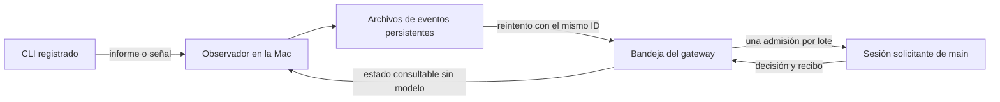

# Avisos de CLI a main sin vigilancia con modelos

Fecha: 2026-09-28. Estado: diseño para revisión. No hay implementación ni despliegue.

## Problema y decisión

U3 y revisor despiertan a main cada cinco minutos y le ordenan leer instrucciones e historiales completos. Sus archivos de estado medían 168 KB y 105 KB durante la inspección. Además existen avisos de tmux, el hook Stop de Claude y el latido de corridas. El envío desde la Mac falla porque su CLI OpenClaw 2026.9.4 no abre la base de esquema 18. El gateway usa 2026.9.6.

La propuesta es observar con código en la Mac, guardar los eventos y entregarlos a una bandeja persistente del gateway. Solo esa bandeja puede solicitar un turno de main por una novedad. Se reutilizan el lanzador, tmux y el registro de corridas; los mecanismos nativos de tareas y ejecución de OpenClaw siguen siendo dueños de los turnos.

La vigilancia sin novedades debe producir cero llamadas al modelo. Un evento real que requiere una decisión sí consume tokens. Un turno puede contener varias llamadas al modelo y herramientas; este diseño no promete una única petición al proveedor por entrega. La reducción se obtiene eliminando los turnos de comprobación y sus lecturas repetidas.

## Uso desde el despachador y desde cualquier CLI

Las siguientes interfaces son propuestas, no comandos instalados. Los ejemplos son pseudocódigo.

```text
# main registra el encargo antes de enviarlo a la terminal.
dispatch = cli_events.assign(
    task="U3/14.7/r2",
    terminal=terminal_instance,
    requester=current_main_session,
    result_contract=WorkerDelivery,
    current_state=current_task_snapshot
)
# El despachador incluye dispatch.token y dispatch.result_path en el encargo.

# zcode, Codex, Grok, Claude o cualquier programa entrega por el mismo contrato.
cli_events.report(
    dispatch.token,
    WorkerDelivery(artifact="resultado.json", digest=content_digest)
)
# Alternativa equivalente: escribir el informe JSON y renombrarlo atómicamente
# a dispatch.result_path. No requiere instalar un hook específico del CLI.

# El turno de main recibe un lote ya asignado a su run, con sus datos compactos.
batch = cli_events.current_batch(current_run_identity)
# Tras tomar la decisión, deja un recibo durable.
cli_events.resolve(
    batch.id,
    outcome=FollowupRegistered(next_dispatch_id),
    evidence=decision_reference
)
```

`assign` vuelve con éxito solo cuando el vínculo del encargo y la observación local están registrados. No se escribe el encargo en la terminal antes de ese punto. Para sesiones ya abiertas, se adopta el encargo vigente sin relanzar el CLI.

El resultado significa que el trabajador entregó algo. No certifica aprobación, calidad, merge ni despliegue. Main sigue verificando lo que corresponda. El servicio de avisos no responde permisos ni ejecuta órdenes tomadas de la pantalla.

## Qué funciona para todos los modelos

El modelo no figura en la identidad de un evento. El mismo modelo puede cambiar dentro de un CLI sin alterar la vigilancia. Cada CLI debe tener una sesión registrada y una forma comprobada de publicar el resultado del encargo.

| Señal | Qué prueba | Tratamiento |
|---|---|---|
| Informe válido con token del encargo actual | Entrega o bloqueo declarado por el trabajador | Evento portable, apto para despertar a main |
| `LISTO` existente en una ruta registrada | Evidencia de entrega de ese encargo, tras validar contenido y generación | Adaptador de compatibilidad para los loops actuales |
| Veredicto estructurado ligado al encargo y revisión | Resultado declarado de la revisión | Mismo circuito de entrega |
| Hook de fin de turno | Terminó un turno del CLI | Reexaminar resultado local; por sí solo no despierta a main |
| Terminal quieta, spinner, cursor o reloj | Estado visual, sin prueba de entrega | Observación local; cero turnos por quietud |
| Permiso identificado por un adaptador comprobado | Hay una pregunta pendiente | Un evento por episodio; jamás se acepta automáticamente |
| Salida/cierre de una sesión con encargo activo | El proceso o sesión terminó | Reexaminar el resultado; sin entrega, informar terminación inesperada |
| Plazo del encargo vencido sin resultado | Falta la señal comprometida | Una incidencia por encargo, sin recordatorios de modelo periódicos |

Un `exit 0` no prueba que el encargo se cumplió. Un texto viejo `VEREDICTO: APROBADO` tampoco. La compatibilidad de finalización rápida se demuestra con el informe portable, o con un adaptador que asocie de forma inequívoca la entrega a ese encargo.

Claude puede usar su Stop como acelerador local. Para zcode, Codex, Grok, OpenCode, Kimi, Muse, Qwen y otros, el informe portable proporciona el camino común. Los hooks específicos son opcionales. Un CLI que no emite resultado, no termina y mantiene una pantalla ambigua no ofrece una señal de fin verificable: queda cubierto por el plazo e incidencias, sin inventar una finalización. Los patrones genéricos de permisos no permiten prometer detección perfecta para un CLI desconocido.

## Flujo y responsabilidades



| Propietario | Responsabilidad y ubicación propuesta |
|---|---|
| Despachador existente | Registrar encargo, terminal y sesión solicitante antes de enviar instrucciones. Integrar `corrida/lanzar-sesion.sh` y la adopción de U3/revisor |
| Observador de la Mac | Concentrar `tmux-activity-watch`, señales Stop y lectura de resultados detrás de `scripts/mac/cli-events.py`; guardar eventos y reenviar sin modelos |
| Integración del gateway | Módulo propuesto `cli-events/`: validar ingreso, conservar recibos, formar lotes y conciliar la admisión con el runtime nativo |
| Main | Consumir el lote, decidir y registrar el resultado con identidad de ejecución |

Son dos propietarios de persistencia: la Mac guarda lo aún no confirmado por el gateway; el gateway conserva lo recibido y su procesamiento. No comparten archivos mutables. Los productores locales escriben archivos individuales con identificadores únicos; el observador es el único que ingiere esos archivos y actualiza su estado.

La bandeja usa almacenamiento nativo si ofrece el contrato requerido. En caso contrario, una base privada del módulo guarda únicamente eventos, recibos y correlaciones. No se editan tablas internas de OpenClaw ni se desarrolla otro planificador de agentes. La integración no se agrega al plugin del tablero, cuyo cometido es presentar progreso.

## Datos y contratos internos

Los nombres de tipos y firmas siguientes describen contratos por construir.

```text
DispatchId       = UUID nuevo por encargo, incluso al repetir taskId
TerminalInstance = hostId + serverIncarnation + paneId + registrationNonce
MainTarget       = agentId="main" + requesterSessionKey verificada
Dispatch         = DispatchId + taskId + generation + TerminalInstance
                   + MainTarget + resultContract + currentStateRevision

Change = WorkerDelivery(artifactRef, digest)
       | ReviewDelivery(artifactRef, reviewedRevision, digest)
       | WorkerBlocked(reasonRef)
       | PermissionRequired(promptIdentity, evidenceRef)
       | UnexpectedTermination(evidenceRef)
       | DeadlineMissed(deadlineIdentity)

Event = eventId + DispatchId + transitionIdentity + Change + observedAt
Receipt = eventId + payloadDigest + durableReceiptId
Batch = batchId + MainTarget + immutableEventIds + boundedEnvelope

State = Pending
      | Submitting(batchId, admissionKey)
      | Running(batchId, nativeRunId)
      | Handled(decisionRef, nativeRunId)
      | NeedsReconciliation(reason, lastKnownRunId)
      | Superseded(reason)

assign(spec, callerIdentity) -> DispatchHandle
report(dispatchToken, change) -> LocalReceipt
status(dispatchOrEventIds) -> StatusSnapshot        # no modelo
current_batch(callerRunIdentity) -> AssignedBatch
resolve(batchId, outcome, evidence, callerIdentity) -> HandlingReceipt

# Frontera interna que debe satisfacer el runtime instalado.
MainAdmission.submit(batch, stableKey, recoveryFence?) -> AdmissionReceipt
MainAdmission.lookup(stableKey) -> NotStarted(recoveryFence)
                               | Running | Finished | Unknown
```

La recepción autenticada comprueba tamaño, token, propietario, generación, ruta permitida y digest. El mismo ID con distinto contenido se rechaza. Rutas y textos son datos, nunca se interpolan en comandos de shell. Ningún evento lleva credenciales ni un volcado completo de la terminal.

Las observaciones equivalentes del archivo, hook y terminal se unen bajo la misma entrega. Si cambia el contenido después de publicar el resultado, se conserva como conflicto; no provoca automáticamente otro turno con cada escritura. Un nuevo encargo siempre obtiene otra generación. Los informes tardíos de generaciones previas se archivan con su identidad y nunca avanzan el encargo actual.

La marca de vigilancia es necesaria, pero una sesión con el mismo nombre no hereda el encargo de una sesión anterior. La instancia de terminal, el token y la generación resuelven esa diferencia.

## Entrega, duplicados y recuperación

1. La Mac persiste el evento antes de tocar la red. Solo archivos completos y renombrados pasan a la cola.
2. El gateway persiste el evento y su ID único antes de confirmar recepción. Repetir el mismo evento devuelve el mismo recibo sin iniciar otra ejecución.
3. La bandeja combina eventos del mismo destino durante una ventana máxima propuesta de un segundo. Un lote ya admitido es inmutable; eventos posteriores esperan otro lote.
4. El gateway persiste la intención de admisión con una clave estable y solicita el turno nativo dirigido a la sesión real de main.
5. Main recibe el lote con identidad de run y registra una decisión mediante `resolve`. Un `agent_end` sin ese recibo deja trabajo sin resolver.

La Mac puede reintentar transporte con pausas crecientes hasta 60 segundos. Estos reintentos son código y no llaman modelos. Una respuesta perdida se resuelve reenviando el mismo ID y consultando su recibo. Los pendientes no caducan ni se eliminan por cambiar de sesión.

Si el gateway cae después de solicitar el turno y antes de guardar el runId, hay una admisión incierta. Se consulta la clave nativa. Un `NotStarted` solo permite reintentar si incluye una garantía nativa durable de que ninguna solicitud anterior con esa clave sigue en vuelo ni puede iniciar después. `submit` debe validar esa garantía atómicamente o reutilizar la admisión existente por la misma clave. Una lectura seguida de una escritura sin esa protección deja una carrera y no cumple el contrato. Un timeout, ausencia de un log o una sesión aparentemente quieta tampoco equivalen a `NotStarted`.

Si el runtime no puede resolver esa incertidumbre, el lote pasa a `NeedsReconciliation` y se muestra como bloqueo operativo. No se reenvía ciegamente ni se declara atendido. Se permite recuperación automática cuando existe evidencia suficiente; si no existe, una alerta determinista avisa al operador y conserva el evento. No se promete ejecución exactamente una vez frente a fallos del proveedor o acciones externas.

Un turno fallido después de iniciar herramientas tampoco se repite automáticamente. Los efectos de main requieren sus propios identificadores: si registró el siguiente encargo antes de fallar, la recuperación debe encontrarlo y reutilizarlo. No basta con deduplicar el aviso.

Mientras main está ocupado, se guarda el lote y se utiliza la cola nativa de esa sesión. No se interrumpe el turno activo, no se abre otra sesión ni se crean subagentes para comprobar su estado. Consultar backlog, recibos y salud no requiere inferencia.

La bandeja tiene un despachador de código que revisa pendientes al arrancar, al ingresar un evento y al recibir una señal nativa de capacidad de la sesión. Un temporizador de recuperación de cinco segundos puede consultar el backlog y estado nativo; con la bandeja vacía no solicita ningún turno. Entrega a la cola nativa únicamente lotes nunca sometidos o recuperables bajo la garantía anterior. No invoca `system event` para averiguar si main está libre. Hay que verificar que esta ruta vuelve a entregar a la misma sesión después de un reinicio y al terminar un turno ocupado. El despachador administra recibos pendientes, mientras el runtime conserva la planificación y ejecución de agentes.

La Mac conserva cada evento hasta confirmar recepción durable. El gateway conserva cada pendiente hasta su resolución explícita. Recibos y marcas de eventos procesados se retienen durante toda la vida de la generación; compactar cuerpos antiguos no elimina las claves necesarias para deduplicar. Tras dormir o reiniciar, se concilian archivos y generaciones antes de admitir novedades.

## Una sola ruta que pueda despertar a main

El cambio debe cubrir todas las fuentes del mismo trabajo:

| Fuente actual | Comportamiento propuesto para los loops gestionados |
|---|---|
| `u3-loop-vigia`, `revisor-loop-vigia` | Retirar sus despertares periódicos tras el cambio de propietario |
| Observador tmux | Publicar hechos locales; eliminar envíos directos y recordatorios periódicos de quietud |
| Stop de Claude y futuros hooks | Publicar una señal local ligada al encargo; nunca llamar al gateway por su cuenta |
| `corrida/latido.sh` | Conservar cálculos/reportes deterministas; entregar acciones mediante la misma bandeja |
| Heartbeats, reintentos y otros cron del mismo loop | Comprobar que ninguno vuelva a pedir al modelo que consulte si ocurrió algo |

No se apagan cron ajenos, como trabajos comerciales o revisiones semanales. La promesa de cero inferencia inactiva se mide para esta vigilancia y sus rutas; no para toda la cuenta de proveedores.

La quietud y los hooks repetidos no crean episodios nuevos. Los cambios de spinner, reloj, cursor y reimpresión no rearman avisos. Un permiso estable se reporta una vez por episodio, validado por el adaptador del CLI. El ruido no reconocido queda visible como diagnóstico local; no se convierte en un turno periódico de interpretación.

## Contexto que recibe main

El destino es la pareja registrada `agentId=main` y `requesterSessionKey`. Se resuelve con la API soportada antes de admitir el encargo. No se supone que la clave siempre sea `agent:main:main` ni se fabrica una sesión `sim9` o aislada.

El sobre propuesto tiene un máximo de 8 KiB, con resúmenes individuales de hasta 1 KiB. Incluye encargo, generación, hecho, última revisión, siguiente decisión esperada y referencias concretas. El exceso se guarda como evidencia y se pagina cuando main lo necesita; no se trunca silenciosamente una cola de eventos.

`estado.md` queda como historial. El estado actual se mantiene por encargo y revisión, separado de ese historial. Las instrucciones dejan de exigir su lectura completa en cada aviso. Las reglas permanentes siguen accesibles; el resumen no autoriza omitir reglas de seguridad o calidad.

La conversión inicial extrae datos verificables del encargo vigente y conserva referencias al historial. Los campos dudosos quedan señalados; no se inventa un resumen automático. Hay que medir el prompt efectivo de main: 8 KiB limita lo añadido por este sistema, no el contexto global, sus herramientas ni el historial previo de conversación.

## Dependencia concreta del gateway

Se verificó en modo lectura la versión Windows 2026.9.6 y su declaración `dist/agent-harness-runtime-wMciqZ6Z.d.ts:27998`. Existe `dispatchHookAgentTurn` con `sessionKey`, `idempotencyKey` y retorno `runId`. Sin embargo, la declaración lo describe como un turno de hook aislado y contenido, y restringe `externalContentSource` a `email`.

Por eso este diseño no usa esa función como si ya probara entrega a la conversación real de main. Tampoco se promete persistencia de su idempotencia tras reiniciar. La primera tarea técnica futura es enlazar `MainAdmission` con la admisión nativa que cumpla esos requisitos, mediante inspección del código instalado y pruebas aisladas. Si hace falta ampliar el runtime para ese contrato, debe formar parte explícita del alcance; no se oculta detrás de un plugin ni se simula cambiando el tipo con un cast.

La comprobación debe demostrar tanto la exclusión atómica de solicitudes anteriores en vuelo como la programación de pendientes a la sesión real después de reiniciar o estar ocupada. Si falta cualquiera, el diseño requiere ampliar la admisión nativa o conservar el estado visible de conciliación. No se da por resuelta esa dependencia mediante una consulta de estado ni por tener el SDK instalado.

El envío desde la Mac debe usar un cliente compatible o una llamada estructurada mediante la conexión SSH existente al gateway. No se degrada la base de esquema 18. `system event --mode now` sigue siendo una alternativa de menor garantía, porque su aceptación es efímera y no demuestra procesamiento. No es la base elegida para recuperación automática fiable.

El despliegue futuro de una integración del gateway puede exigir recarga o reinicio según la instalación. No está autorizado en esta tarea y el diseño no promete instalación en caliente. Debe hacerse en una ventana comprobada sin trabajo activo. Las sesiones CLI existentes no se reinician para adoptar el protocolo.

## Cambio de sistema sin perder entregas

1. Inventariar las rutas anteriores y guardar sus configuraciones. Resolver el contrato nativo pendiente sin modificar producción.
2. Preparar captura local y bandeja en modo observación, con admisión deshabilitada. Adoptar las tareas actuales y sus terminales. Clasificar cada `LISTO` previo como ya consumido, pendiente actual o generación antigua; no descartar todos los archivos anteriores por su fecha.
3. Preparar el consumo y recibo de main y el estado compacto. Los CLI continúan trabajando y toda novedad queda guardada.
4. En un límite seguro del despachador, cerrar las rutas antiguas de despertar para ese loop y deshabilitar los dos cron exactos. Conciliar avisos ya encolados y turnos en vuelo. Si no se puede determinar si consumieron un resultado, mantener el nuevo lote sin admisión hasta resolverlo.
5. Activar un único propietario de admisión con una revisión de configuración registrada. Releer el backlog, descontar resultados ya atendidos y admitir los pendientes.
6. Comprobar que las rutas antiguas no se recrean desde `PROMPT.md`, skills, lanzadores o reparadores. Actualizar esas instrucciones también forma parte del fix.

La captura se mantiene durante la transición: puede existir una pausa acotada de entrega, pero no una pérdida de observación. El rollback cierra admisión, preserva pendientes y publica estado degradado. Reactivar los cron costosos no es un rollback automático. La recuperación usa una única ruta validada y nunca reproduce lotes inciertos a ciegas.

## Criterios de aceptación para la implementación futura

| Caso | Evidencia exigida |
|---|---|
| 72 horas simuladas sin novedades, plazos aún no vencidos | Cero admisiones de main y cero solicitudes al proveedor atribuibles a vigilancia |
| Stop repetido, reloj, spinner, panel quieto, resultados históricos | Cero despertares |
| Informe nuevo válido | Un evento semántico, un lote y una ejecución inicial; recibo de decisión |
| Mismo evento reenviado 100 veces, respuesta perdida | Un recibo durable y ninguna ejecución adicional |
| Informe y hook simultáneos | Una entrega; el hook no produce otro turno |
| Archivo parcial, token inválido, ID con payload distinto | Rechazo o espera explícita, nunca avance de tarea |
| Terminal reutilizada y callbacks antiguos | Nada se atribuye al encargo nuevo |
| Dos entregas mientras main está ocupado | Permanecen en cola; un escritor por sesión, sin interrupción ni agente vigía |
| Reinicio con lote pendiente y fin del turno que bloqueaba la cola | El despachador de código lleva el lote a la misma sesión real, sin otro evento externo, nueva sesión ni sondeo mediante modelo |
| Caídas antes/después de persistir, admitir o confirmar manejo | Recuperación por identidad; incertidumbre visible, nunca reintento de modelo por timeout |
| Primera solicitud demora y llega después de consultar `NotStarted` | El fence/idempotencia nativo impide dos admisiones; sin esa garantía el lote queda en conciliación |
| Se ejecutó una acción pero faltó el recibo | Se encuentra la acción existente; no se repite el efecto |
| CLI sin informe o permiso desconocido | No se afirma éxito; plazo/diagnóstico visible con incidencia acotada |
| Reinicio o suspensión de Mac/gateway | Resultados pendientes preservados y conciliación por generación |
| Todas las rutas antiguas | No existe llamada alternativa que vuelva a despertar por reloj |
| Lecturas del turno real | No relee historiales completos; se registra el tamaño real del prompt |

La matriz portable incluye zcode/glm, Codex, Grok, Claude Code, OpenCode, Kimi, Muse, Qwen, Cursor, los demás ejecutables registrados y un CLI ficticio sin hooks. Se prueba cada adaptador de permisos por separado. El CLI ficticio demuestra que la entrega no depende del proveedor; no sustituye comprobar los clientes usados de verdad.

Objetivo inicial de detección: hasta 5 segundos desde un resultado estable; permisos reconocidos, hasta 15 segundos. Objetivo de recepción: hasta 5 segundos adicionales con hosts despiertos y red saludable. El inicio y fin de main dependen de su turno activo, capacidad y proveedor. Se miden esas latencias por separado. No se promete respuesta instantánea si la Mac duerme o el gateway está caído.

Un aviso pendiente sin progreso se hace visible antes de dos minutos como transporte caído, main ocupado o admisión incierta, según la evidencia. La alerta es código sin modelo y usa el canal operativo que se autorice durante el despliegue; el estado local siempre existe. Una espera legítima detrás de main no se reintenta como si fuera un fallo.

Las pruebas de lógica y recuperación usan dobles del runtime y reloj controlado. Antes de producción hace falta una verificación acotada real de entrega a la sesión correcta y del contador de solicitudes. No se ejecutó ninguna prueba con modelos en esta fase de diseño. Las pruebas del fix deben discriminar cada fallo corregido y respetar los candados del repo; la batería completa se corre una vez sobre el SHA final.

## Alternativas y síntesis

Se compararon dos diseños independientes. Ambos obtuvieron 9/12 en revisión de arquitectura. El diseño centrado en la Mac tiene menor coste de integración, pero reenviar un `system event` incierto puede generar otra llamada al modelo. Limitarlo a dos intentos acota el daño sin resolver la pérdida de eventos.

Se eligió la bandeja del gateway como objetivo porque coloca la deduplicación antes de la admisión del turno y junto a la evidencia de ejecución. De la alternativa Mac se conservan el almacenamiento local, el contrato portable de informe, las identidades por encargo y el estado visible de recuperación. Se rechazan los reintentos ambiguos por reloj y cualquier despertar basado solo en quietud.

Se acepta mayor trabajo de integración a cambio de recibos y recuperación verificable. Se acepta que una ambigüedad sin evidencia requiera intervención antes que un bucle ilimitado de inferencia. El runtime nativo debe satisfacer el contrato de admisión; la existencia de un parámetro `idempotencyKey` por sí sola no demuestra esa garantía.

Principios de poteto aplicados: `fix-root-causes` reemplaza el chequeo con modelos por señales verificables; `model-the-domain` distingue entrega, recibo, ejecución y decisión; `separate-before-serializing-shared-state` asigna un dueño a cada estado mutable. La revisión y su comparación están en `revision.md`.

El siguiente paso de implementación, si se autoriza después de revisar este diseño, es comprobar `MainAdmission` en la versión instalada y construir las pruebas de identidad, recepción y caídas antes de conectar el observador a producción.

## Evidencia consultada

- [Observador actual](/Users/dn/dev/goncloud-openclaw/scripts/mac/tmux-activity-watch.sh), [hook de Claude](/Users/dn/dev/goncloud-openclaw/scripts/mac/claude-stop-openclaw-event.sh), [registro al lanzar](/Users/dn/dev/goncloud-openclaw/scripts/mac/corrida/lanzar-sesion.sh), [estado](/Users/dn/dev/goncloud-openclaw/scripts/mac/corrida/estado.sh) y [latido](/Users/dn/dev/goncloud-openclaw/scripts/mac/corrida/latido.sh).
- Inspección de solo lectura: cron vivos, archivos de los loops, logs de error del observador, versiones Mac/Windows y declaraciones del SDK instalado. Los logs muestran el fallo de esquema; las cifras de tokens por vigía proceden del reporte de Claw y no de una auditoría de facturación.
- [Eventos del sistema](https://docs.openclaw.ai/cli/system): aceptación y despertar, eventos efímeros.
- [Hooks](https://docs.openclaw.ai/gateway/config-hooks): una respuesta de recepción no acredita ejecución del agente.
- [Tareas de fondo](https://docs.openclaw.ai/automation/tasks): seguimiento nativo y límites de recuperación.
- [SDK de trabajo de fondo](https://docs.openclaw.ai/plugins/sdk-runtime/background-work): API documentada contrastada parcialmente con declaraciones instaladas, sin prueba de sus garantías operativas.
