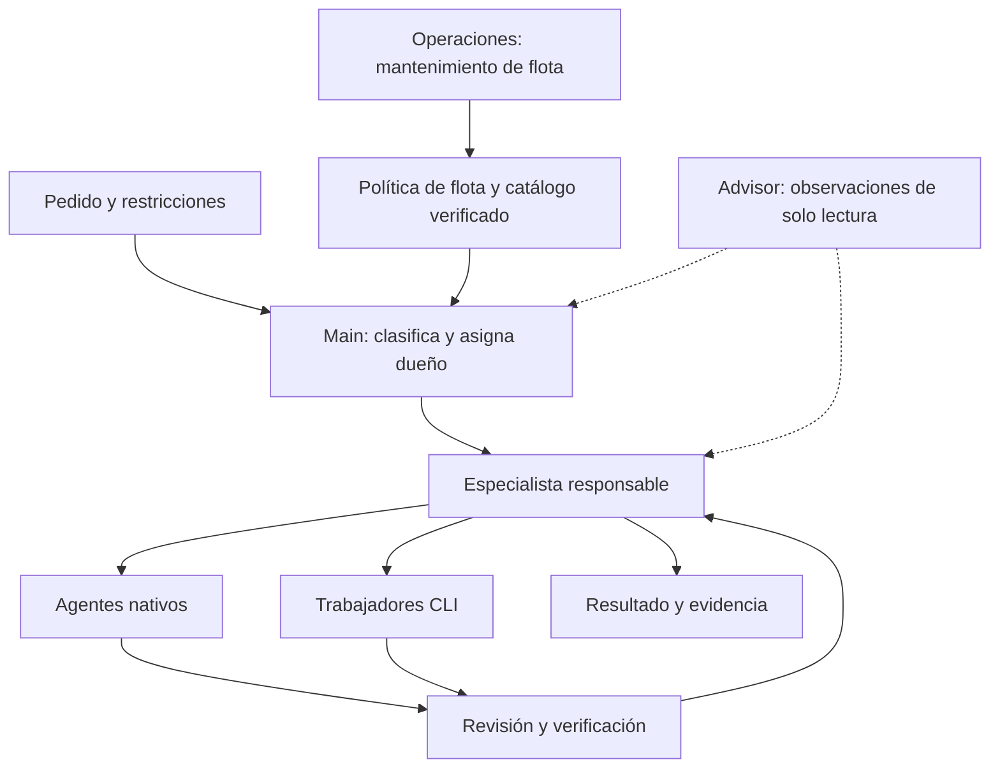

# Contrato de flota para OpenClaw y CLI

> **Antecedente desde 2026-10-05.** Para trabajo futuro rige el [plan único SUA](../plans/2026-10-05-sistema-agentes-unificado.md) y su diseño. Este documento conserva historia y evidencia; sus órdenes, dependencias y políticas incompatibles quedan sustituidas. No ejecutar como programa paralelo. El encargo actual autoriza sólo diseño.

Estado: especificación de diseño. Alcance autorizado: documentación únicamente.
Complementa el [diseño y su fundamento](2026-10-04-flota-poteto-design.md).
Los tipos, módulos, eventos y valores siguientes son decisiones propuestas.
No describen funciones ya instaladas. No se ejecuta este documento como runbook.

## 1. Resultado que recibe David

Un pedido conserva su objetivo, restricciones y criterios de aceptación durante
la delegación. OpenClaw explica quién lo hará, con qué modelo y por qué. La
respuesta final distingue trabajo verificado, pendiente y bloqueado.

Para un pedido de Amazon, main asigna el dominio a amazon. Para implementar un
plan, main asigna ingeniería, que divide unidades y utiliza agentes nativos o
CLI según las capacidades necesarias. El revisor y el verificador devuelven
sus resultados al dueño de la tarea. David puede fijar un agente, modelo o
modo de solo diseño; esa instrucción limita todas las delegaciones posteriores.



La política prepara asignaciones. Los propietarios actuales de encargos y
corridas conservan sesiones, colas, presupuesto, cancelación y resultados.

## 2. Responsabilidades

| Actor | Decide o produce | Límite |
|---|---|---|
| main | Clasificación, dueño, alcance y aceptación global | No suplanta al especialista ni amplía autoridad del pedido |
| ingenieria | Unidades, dependencias, archivos y selección del ejecutor de código | Respeta el modo de diseño y el propietario nativo de cada encargo |
| operaciones | Salud, inventario, reconciliación y aplicación autorizada | No decide resultados de negocio ni revisa su propio cambio |
| Especialista | Procedimiento, fuentes, herramientas y aceptación de su dominio | Solo recibe datos y permisos de su especialidad |
| implementer o CLI | Artefactos y pruebas de la unidad asignada | No aprueba su propio trabajo |
| reviewer | Hallazgos sobre artefacto y revisión exactos | No cambia el alcance ni escribe el arreglo que revisa |
| adversary | Contraejemplos sobre supuestos y riesgos seleccionados | Se activa por riesgo, novedad o petición explícita |
| verifier | Reproduce criterios de aceptación | Una declaración del implementador no sustituye evidencia |
| scout | Investigación con referencias y límites de certeza | No convierte una hipótesis en capacidad confirmada |
| skillverif | Dependencias, adaptación y vigencia de skills | No habilita permisos de negocio por instalar una skill |
| Advisor | Observaciones puntuales para el dueño | No escribe código, despacha, publica ni aprueba entregas |

Los roles son responsabilidades. Pueden ocuparlos agentes existentes o sesiones
separadas autorizadas. Advisor es un rol de sesión; no exige crear otro agente.
Una persona/modelo puede participar en tareas distintas, pero quien implementa
no es el único revisor de ese mismo artefacto.

Los 19 IDs observados son un inventario inicial, nunca una allowlist estática.
No se infiere el dominio de pers, arras, gonserver, tinkabot o eggbot por el nombre.
Su incorporación usa su perfil efectivo y una prueba de capacidad, igual que
cualquier agente futuro. Los perfiles ausentes permanecen visibles como pendientes.

## 3. Datos y módulos

Las ubicaciones siguientes son propuestas. La implementación futura validará sus
fronteras contra las versiones instaladas antes de conectarlas.

| Módulo propuesto | Entrada | Salida y propietario |
|---|---|---|
| `fleet/policy` | Política, inventario y evidencia validados | Proyecciones puras, sin red ni sesiones |
| `fleet/catalog` | Catálogos de proveedor y disponibilidad por cuenta/runtime | Evidencia normalizada con origen y caducidad |
| `fleet/context` | Poteto canónico, adaptación, especialidad y tarea | Paquete mínimo con digest y dependencias |
| `fleet/adapters/openclaw` | Proyección nativa y revisión esperada | Cambio administrado y lectura efectiva del gateway |
| `fleet/adapters/cli` | Proyección CLI y revisión esperada | Registro y paquetes de arranque versionados |
| `fleet/reconcile` | Snapshot observado y política versionada | Diferencias, estados y solicitudes de aplicación |
| Propietarios actuales | Asignación preparada y autoridad vigente | Admisión, ejecución, recibos y resultados |

Tipos conceptuales mínimos:

```text
TaskSpec = id, revision, goal, acceptance[], constraints, mode,
           authorityRef, dataScope, budgetRef, dependencies[]
mode = design | readOnly | implement | release

ExecutorProfile = target, specialtyRef, acceptedTaskKinds[], excludedScope[],
                  toolRequirements[], dataScope, allowedParents[],
                  allowedChildren[], returnRoute, publicationScope, runtimeCapabilities, enabled

ModelPolicy = familyPreferences[], updateChannel=stable, automaticSuccessors,
              requiredCapabilities[], budgetLimits, optionalExplicitPin

ModelEvidence = exactId, family, provider, accountRef, runtime, releaseSource,
                successorOf[], stability, accessProbe, capabilityProbe,
                observedAt, validUntil, runtimeRevision

InstructionBundle = canonicalSourceRevision, potetoDigest, mappingDigest,
                    specialtyDigest, skillDigests[], taskDigest, bundleDigest

NativeTaskRef = installationId, hostId, runtimeId, taskId, rootId,
                nativeGeneration, attemptId, verifiedResourceRefs[]
GoalBindingRef = referenceToU6GoalTaskBinding

Assignment = nativeTaskRef, taskRevisionRef, optionalGoalBindingRef, target, exactModelId,
             modelEvidenceRef, fleetGeneration, bundleDigest, authorityRef,
             workOwnership, acceptanceDigest, budgetRef

ActivationReceipt = targetScope, fleetGeneration, projectionDigest,
                    observedRuntimeRevision, instructionEvidenceRef,
                    probeEvidenceRef, activatedAt

Result = nativeTaskRef, artifactRevision, acceptanceResults[],
         evidenceRefs[], unresolved[], status
```

Los identificadores de NativeTaskRef proceden del dueño nativo o de su mapeo
portable U4. Flota no crea una segunda identidad de tarea ni reserva de recursos.
`fleetGeneration` versiona configuración; no sustituye `nativeGeneration` ni la
revisión de meta. `optionalGoalBindingRef` referencia el vínculo definido por
U6.1 cuando existe una meta. Las extensiones de esquemas nativos estrictos se
versionan en el repositorio dueño antes de usarlas.

`accountRef` referencia una credencial almacenada por el runtime. Los contratos
no transportan tokens ni contenido de buzones. Una revisión de tarea invalida
asignaciones aún no admitidas y evidencia que depende del criterio modificado.

Interfaces conceptuales:

```text
observe(scope) -> ObservedSnapshot | ObservationFailure
reconcile(snapshot, policy, evidence, now) -> ChangeSet + ReadinessReport
prepare(task, target, activeReceipt, now) -> Assignment | Ineligible(reason)
apply(changeSet, expectedRevision, authority) -> Applied | Conflict | Failed
attest(applied, runtimeObservation, probe) -> ActivationReceipt | Unverified
```

`prepare` no arranca sesiones. La admisión existente persiste la asignación antes
del lanzamiento. `apply` no puede emitir su propio recibo de verificación sin
lectura y prueba del runtime. La serialización tiene versión de esquema; una
versión desconocida se rechaza sin modificar la generación activa.

## 4. Selección y reparto de trabajo

La selección tiene este orden, con el motivo registrado en cada descarte:

1. Aplicar instrucciones explícitas de David y el alcance de datos autorizado.
2. Elegir el dominio y el especialista con tipos de tarea compatibles.
3. Filtrar ejecutores por herramientas, permisos, poteto y estado operativo.
4. Filtrar modelos por acceso y capacidades comprobadas para ese runtime.
5. Elegir entre los elegibles por calidad observada en el dominio, presupuesto,
   latencia y disponibilidad. Un empate conserva la asignación vigente y luego
   usa el ID estable como desempate, para evitar cambios sin mejora.
6. Crear una asignación con modelo, instrucciones y aceptación fijados.

El selector propio de cada runtime aplica este orden mediante filtros de
elegibilidad y preferencias; la política no introduce un segundo selector de
sesiones. Sin candidato compatible, devuelve la carencia y las unidades
independientes pueden continuar. No degrada una restricción explícita.

Las preferencias actuales, por ejemplo Claude para revisar y GLM o Muse para
implementar, se expresan como preferencias editables, no nombres escritos en
la lógica. Kimi, DeepSeek, GPT, Grok y otros entran por las mismas capacidades.
La identidad de un launcher como Muse se registra separada del modelo resuelto.
Toda asignación de esta flota exige identidad de modelo verificable. Un router
que no informa modelo inmutable permanece visible y no elegible hasta que su
adaptador acredite esa capacidad. El nombre del launcher no sustituye ese dato.

Todo cambio de código exige un revisor distinto del autor. En ingeniería U3b
exige además un harness distinto del implementador vigente, validado tras cada
relevo. El revisor trabaja con asignación
propia, objetivo, diff y evidencia delimitados. La verificación de aceptación
se mantiene separada del juicio del revisor.

La calidad se obtiene de pruebas y resultados registrados por dominio. Sin
mediciones, se usa la preferencia configurada y se declara falta de comparación.
No se inventa una puntuación de confianza como la mostrada en la imagen.

Una tarea pequeña usa el menor equipo que pueda ejecutarla y verificarla.
Para metas compuestas, U6 conserva el DAG y habilita las unidades. Ingeniería
consume esas unidades y elige sus ejecutores mediante la flota. Solo se
paralelizan unidades independientes. Dos escritores no comparten archivos,
rama ni estado mutable; trabajan en worktrees o recursos separados. El dueño
integra por orden de dependencias y vuelve a verificar los criterios afectados.

Los hijos heredan alcance y presupuesto restantes. No crean un presupuesto nuevo
ni consiguen permisos por delegación. Los ciclos se rechazan y la profundidad y
concurrencia usan los límites existentes del runtime. Un objetivo amplio conserva
la cobertura de todos sus criterios, aunque una unidad termine antes que otra.

## 5. Advisor, adversario y revisión

El advisor recibe eventos del propietario existente al aceptar el plan, cambiar
alcance, repetir un fallo y proponer el cierre. Para observar cada turno o tool
call, el adaptador debe acreditar una fuente de eventos completa; si no existe,
el estado se llama `checkpoint-only` y no promete observación continua.

También se consulta al advisor ante un reparto entre varias especialidades,
una correspondencia ambigua o consecuencias elevadas. Puede recomendar una
descomposición, pero no atribuir una competencia sin perfil y prueba.

Cada evento incluye tarea, intento, secuencia, artefacto afectado y referencias
de evidencia. Se deduplica por esos identificadores. Se aplican los mismos
límites de datos que al resto de delegados, con resúmenes y fragmentos pertinentes.

El advisor responde `no-observation` o una observación con afirmación, evidencia,
impacto y acción propuesta. Un timeout se registra como `unavailable`, nunca
como aprobación. Su consejo no cambia la asignación por sí solo. El dueño
resuelve y registra el motivo. La falta del advisor no sustituye ni elimina una
revisión obligatoria. Si el pedido exige advisor, su ausencia impide ese paso.

El adversario busca contraejemplos de un supuesto concreto. El reviewer revisa
el artefacto. El verifier ejecuta la aceptación. El diseño no presupone que
`claude --advisor fable` sea una interfaz disponible o portable. Cada adaptador
expone capacidades medidas y aplica el rol mediante su API real.

Las revisiones agrupan hallazgos. Solo un bloqueante reproducible abre otra
ronda; otro revisor examina el diff de la corrección. El mismo bloqueante en dos
rondas consecutivas detiene esa unidad para decisión del operador. Lo no
bloqueante sigue la regla del quality-kit y no provoca revisiones sin fin.
La diversidad de proveedor es preferible cuando está disponible; si el contrato
exige revisión cruzada y no hay otro proveedor, la compuerta queda pendiente.

## 6. Renovación automática de modelos

Operaciones será responsable de un trabajo `fleet-reconcile` en el scheduler
nativo. El registro se hace mediante la API pública de trabajos del scheduler del
gateway. No se crea un daemon ni se usa una sesión de chat como reloj. Su admisión
y exclusión de ejecuciones simultáneas pertenecen al scheduler existente.

Disparadores propuestos:

| Disparador | Trabajo |
|---|---|
| Arranque o recuperación del gateway | Inventario y comprobación de revisiones |
| Cambio de configuración de agentes/modelos/skills | Reconciliación del ámbito afectado |
| Cada hora | Respaldo de descubrimiento por si falta un evento |
| Cada 24 horas | Catálogos, fuentes de lanzamiento y vigencia de capacidades |
| Error de acceso o de capacidad | Invalidación inmediata del candidato afectado |
| Pedido de usar un modelo recién publicado | Refresco dirigido antes de asignar |

Antes de admitir un trabajo, el propietario comprueba la preparación vigente.
Si necesita refresco solicita la misma reconciliación y deja esa admisión
pendiente. No ejecuta un ciclo alternativo ni duplica el mantenimiento. Si el
scheduler no está disponible, el informe muestra mantenimiento no instalado y
no acredita renovación automática durante inactividad.

Las cadencias son valores iniciales de diseño, no umbrales medidos. Son
configurables. Los fallos reintentan a 1, 5 y 15 minutos y después en el ciclo
horario, dentro del presupuesto existente. Se conserva el informe de fallo.

Cada proveedor tiene un adaptador declarativo de fuente oficial de catálogo,
fuente de estabilidad/sucesión y comprobación de acceso. Los adaptadores nuevos
entran por el mismo contrato. Un nombre más grande no demuestra sucesión.
Si no hay fuente interpretable, el candidato figura `release-evidence-missing`.
El sistema actualiza automáticamente cuando la evidencia puede comprobarse;
no inventa estabilidad para cumplir la palabra automático.

Por defecto se promueve el sucesor estable dentro de la familia preferida y
con las capacidades requeridas, después de una prueba aislada sin efectos de
negocio. No se comparan generaciones numéricas entre proveedores. Cambiar de
familia es una decisión de selección permitida por ModelPolicy, con motivo.
Un pin explícito de David prevalece hasta su caducidad o revocación.

La prueba de acceso tiene una vigencia inicial máxima de 24 horas. Cambiar la
versión del runtime, credencial referenciada o capacidades invalida su prueba.
La evidencia histórica de lanzamiento se conserva; una retirada del proveedor
invalida la elegibilidad. Cuota agotada produce indisponibilidad temporal, no
una falsa declaración de que el modelo fue retirado.

Una promoción modifica únicamente asignaciones futuras. Cada intento ya
admitido conserva un snapshot inmutable del modelo, argv y paquete de contexto.
Si el modelo fijado deja de existir, el propietario termina ese intento con
causa y crea un intento nuevo autorizado con evidencia del relevo. No etiqueta
el nuevo modelo como reanudación del anterior.

Las pruebas tienen presupuesto por cuenta y una por combinación de modelo,
runtime y contrato de capacidades vigente. Se reutiliza evidencia válida.
Al agotar presupuesto se aplaza la promoción; no se consume el de una tarea de
negocio ni se baja calidad para forzar un resultado.

## 7. Incorporación y retiro de agentes

El inventario se reconcilia por autoridad remota y por ID estable. Se comparan
agentes configurados, publicados, delegables y efectivamente capaces. La
presencia en una sola lista no equivale a estar listo.

Estados de preparación:

```text
Discovered -> NeedsProfile | NeedsAccess | NeedsInstructions | NeedsProbe
requisitos satisfechos -> Ready
cambio incompatible o revocación -> Suspended
retiro configurado -> Retiring -> Retired
```

Un agente nuevo con perfil válido recibe automáticamente las aristas declaradas
por una plantilla ya autorizada, el contexto de su dominio y una prueba de
ida y retorno. Su recibo Ready lo incorpora al selector. No hace falta editar
una lista de nombres en código ni pedir que main lo recuerde en su prompt.

Si carece de perfil, operaciones prepara una propuesta usando sus documentos
existentes. Skillverif valida fuentes y dependencias; una prueba acredita su
capacidad. Nunca se inventan permisos ni identidad a partir del nombre. Si la
plantilla no cubre un nuevo permiso, queda `NeedsAccess` con la acción exacta.
Su existencia permanece visible y se vuelve a evaluar al corregir el dato.

La publicación usa destinos expresamente autorizados. El alta registra destino,
archivos administrados y preservación de memoria. No amplía en silencio la
allowlist actual de sync seguro. La autorización de una plantilla permite altas
automáticas dentro de su ámbito, sin aprobar cada agente de nuevo.

Al retirar un agente se detiene admisión nueva. Las tareas activas concluyen o
se cancelan según la autoridad vigente; no se duplican en otro agente. Se retiran
sus aristas después y se conservan los recibos que explican tareas históricas.

## 8. Poteto y contexto especializado

La fuente canónica es una revisión fijada del árbol pstack aprobado. Se conserva
su procedencia y su grafo de dependencias. La copia detectada bajo grok se trata
como material por comparar, no como autoridad implícita por estar instalada.

Cada paquete contiene, en este orden lógico:

1. Referencias al alcance, autoridad y restricciones del pedido.
2. Poteto canónico y adaptación de herramientas al runtime.
3. Perfil de la especialidad y procedimiento aplicable.
4. Skills requeridas por ese procedimiento y sus dependencias.
5. Datos y evidencia pertinentes a la tarea.

La conversación completa de main no se hereda. La memoria pertinente se
consulta con procedencia y control de datos. Las restricciones de herramientas
se aplican mediante permisos efectivos del runtime, además de describirse en
el perfil; un prompt no constituye un control de acceso.

Las instrucciones del usuario mantienen su precedencia. Poteto no concede
permisos. Una adaptación cambia nombres de herramientas y limitaciones del
runtime; no puede omitir silenciosamente requisitos del método. Si falta una
capacidad obligatoria, ese ejecutor no se considera preparado para el playbook.

El perfil declara propósito, tareas admitidas/excluidas, herramientas, fuentes
con revisión y vigencia, skills permitidas, criterio de calidad y prueba de
capacidad. Una muestra de correo debe probar selección de contexto y resultado
sin enviar correo real. Amazon y Meli usan fixtures representativos de su
dominio. Los demás agentes reciben pruebas derivadas de su perfil, no de su ID.

El presupuesto de contexto parte de la ventana efectiva del modelo, reserva
salida y herramientas, y asigna el resto a instrucciones y evidencia. Se carga
solo la clausura de dependencias del playbook. Si no cabe, se divide la tarea o
se elige otro ejecutor; no se recorta poteto ni un criterio de aceptación.

Las fuentes volátiles tienen vigencia declarada por el perfil y comprobación
antes de una decisión que dependa de ellas. Caducidad de una fuente de dominio
bloquea esa decisión hasta refrescarla. Caducidad de una prueba de promoción
bloquea promociones; por sí sola no cancela un intento activo fijado.

Los archivos administrados viven en paquetes versionados separados. Una edición
manual concurrente genera conflicto de reconciliación. La limpieza retira solo
archivos administrados que no referencia ninguna generación o intento retenido.
Memoria, mensajes, credenciales y notas del usuario quedan fuera de la limpieza.

## 9. Entrega comprobable en cada runtime

| Ruta | Mecanismo exigido por el diseño | Evidencia |
|---|---|---|
| Turno nativo directo | Preparación antes de construir/admitir el turno | Modelo y bundle del turno observado |
| Hijo nativo | Admisión del hijo con asignación propia | Recibo del hijo, no solo del padre |
| Encargo gestionado | Contrato en el propietario nativo | Vínculo tarea/intento/generación |
| Arranque CLI | Snapshot de argv y contexto antes de lanzar | Identidad efectiva y paquete consumido |
| Reanudación CLI | Snapshot del intento original | Ausencia de sustitución por registro nuevo |
| Hijo creado por CLI | Herencia comprobada o contrato propio | Recibo por hijo y límites heredados |

La comprobación combina observación de instrucciones efectivamente entregadas
con una tarea de comportamiento representativa. Un eco del nombre poteto o un
archivo escrito en disco no basta. Los recibos guardan digests y referencias
sanitizadas, no prompts completos con datos privados.

Para OpenClaw, el punto de extensión debe cubrir las seis rutas aplicables.
El hook actual de `summa-gate` no se considera prueba de cobertura total. Si el
runtime no ofrece intercepción y observación necesarias, su adaptador declara
`NeedsRuntimeVerification`; la extensión del runtime es un requisito de
implementación, no un permiso para declarar cumplimiento con un prompt.

## 10. Activación, concurrencia y recuperación

Una generación pasa por `Prepared`, `Applied`, `Verified` y `Active`, o queda
`Failed`. Cada runtime tiene puntero activo y recibo propios. Solo `Verified`
puede sustituir ese puntero mediante comparación con la revisión esperada.

Los documentos y comandos son inmutables por generación. El cambio del puntero
es la operación pequeña que se serializa. El reconciliador no modifica sesiones
activas. Dos procesos con la misma entrada preparan el mismo digest; solo el
propietario con revisión vigente puede activar. Un conflicto obliga a observar
y recalcular, nunca a sobrescribir la edición ajena.

Si hay un corte tras aplicar, el siguiente ciclo lee el runtime y completa la
atestación o revierte el cambio administrado usando la revisión esperada. No
repite efectos de negocio. Si el runtime no admite aplicación atómica, su
propietario cerca la admisión del ámbito durante aplicación y atestación. Si no
puede cercarla, la activación queda pendiente para una ventana compatible.

Si CLI se activa y nativo falla, se informa el resultado por runtime. Se conserva el recibo
nativo anterior como referencia. Si hubo aplicación sin atestación, la admisión
de ese ámbito queda cercada hasta verificar la nueva generación o acreditar
la restauración de la anterior. El recibo viejo no prueba el estado vivo. Una tarea que necesita ambos solo arranca
si sus recibos son compatibles con el mismo contrato. Nunca se declara éxito
global usando solo el recibo CLI.

La reversa reactiva una generación anterior todavía válida, con lectura y prueba.
No revive permisos revocados ni modelos retirados. Las herramientas
administrativas existentes siguen disponibles para reparar una flota no preparada;
la preparación no depende de arrancar un agente bloqueado por ella misma.

## 11. Observabilidad y cierre

El informe de flota muestra por ejecutor especialidad, estado, causa, modelo
resuelto, generación, evidencia vigente y última comprobación. Incluye agentes
sin perfil, candidatos rechazados y ámbitos inaccesibles. No confunde una lista
vacía con una consulta fallida.

Cada decisión registra tarea, actor, motivo, entradas versionadas y evidencia.
Se reutilizan el seguimiento y almacenamiento de los propietarios existentes.
No se crea un ledger de ejecución paralelo. Los paquetes duran al menos mientras
un intento o recibo retenido los referencia; su eliminación sigue la política de
retención existente y no forma parte de una corrida de negocio.

Cerrar una unidad exige resultado y pruebas de su revisión exacta. U6 decide el cierre agregado de una meta a partir de sus criterios vigentes,
revisión y recibos aplicables. Flota aporta evidencia de preparación y ejecución;
no emite un veredicto agregado alternativo. Un timeout, un asesor silencioso o `LISTO` sin
evidencia no producen cierre.

## 12. Aceptación del diseño y de su futura implementación

| Requisito | Decisión cerrada | Prueba futura que discrimina |
|---|---|---|
| Ambos runtimes | Política compartida; propietarios actuales ejecutan | Mismo tipo de tarea recorre nativo y CLI con recibos propios |
| Cualquier proveedor | Adaptadores y selección por capacidad/cuenta | Dos proveedores elegibles y uno sin acceso producen selección explicada |
| Sucesor automático | Operaciones y scheduler; evidencia estable y prueba | Un sucesor se activa sin edición manual y un preview se rechaza |
| Sin cambiar tareas activas | Snapshot por intento | Promover entre arranque y resume conserva el modelo original |
| Agentes nuevos conectados | Descubrimiento y plantillas autorizadas | Alta posterior al arranque aparece y recibe/retorna tarea |
| Agente incompleto visible | Estados con causa | Alta sin perfil no desaparece ni recibe trabajo incompatible |
| Especialización real | Perfil, herramientas, fuentes y aceptación | Prueba positiva de dominio y negativa fuera de alcance |
| Contexto limpio | Dependencias por tarea y paquetes administrados | Skill ajena no entra; memoria del usuario se conserva |
| Poteto obligatorio | Paquete y atestación por ruta | Quitar poteto impide admisión; las rutas de sección 9 acreditan entrega |
| Reparto y revisión | Unidades, aislamiento y revisión independiente | Dos unidades paralelas no comparten escritor; hallazgo vuelve al dueño |
| Advisor | Eventos, observaciones y límites | Caída se informa unavailable y no equivale a aprobación |
| Fallo parcial | Recibos y activación por runtime | Corte entre apply y attest no produce activación falsa |
| Concurrencia | Revisiones esperadas y generaciones inmutables | Dos reconciliadores no pisan cambios ni duplican efectos |
| Fuentes caducadas | Invalida el ámbito que depende de ellas | Fuente de dominio vencida bloquea esa decisión, no toda la flota |
| Autoridad | Herencia restrictiva y revalidación | Un hijo no envía mail si el pedido autorizó solo borrador |
| Solo diseño | TaskSpec.mode se propaga | Delegados no reciben capacidades de implementación o publicación |

La implementación futura tiene este orden de dependencias: contratos y snapshots;
adaptaciones y entrega de poteto; perfiles y alta; renovación de modelos; ensayos
integrados y publicación por runtime. F.1–F.4 de Plans.md son trabajo futuro,
no autorización vigente para ejecutarlo.

El diseño queda cerrado cuando cada requisito tiene propietario, entrada,
salida, fallo definido y aceptación. Las capacidades del runtime pendientes de
medir son condiciones de integración explícitas. Ninguna puede omitirse para
marcar completa la futura implementación.

## 13. Paquete de pedido y ejemplos

Este es el contrato de contenido para los prompts que main entrega al dueño.
Su forma no sustituye la validación ni los permisos del runtime.

```text
Objetivo: <resultado observable>
Modo: <design | readOnly | implement | release>
Criterios de aceptación: <lista verificable>
Restricciones del usuario: <texto fiel y referencias>
Especialista responsable: <ID elegido por perfil>
Trabajo delegado: <unidad, dependencias y archivos/recursos propios>
Autoridad y datos: <referencias, sin credenciales>
Modelo e instrucciones: <referencia a Assignment y bundle preparado>
Presupuesto: <referencia heredada>
Retorno: <propietario y contrato Result>
Revisión: <criterios, revisor y verificador requeridos>
Ante carencias: devolver causa y evidencia; no ampliar permisos ni simular éxito.
```

Ejemplo de ingeniería. David pide diseñar la renovación de modelos. Main fija
`mode=design`, asigna ingeniería y entrega los criterios. Ingeniería consulta
scout y adversary con tareas de lectura. Reviewer verifica cobertura y
contradicciones. El resultado es un diseño y sus límites. No se crean tareas
de implementación, commits de código ni despliegues por interpretar «terminar».

Ejemplo de implementación futura. Un pedido explícito para implementar un plan
permite a ingeniería separar dos módulos independientes. Cada trabajador recibe
su contrato, worktree y poteto adaptado. Uno puede ser un agente nativo y otro
una CLI. Reviewer examina los artefactos y verifier ejecuta aceptación. El dueño
integra y responde solo con la cobertura acreditada del plan.

Ejemplo de especialista nuevo. Operaciones descubre un agente después del
arranque. Un perfil válido dentro de una plantilla autorizada permite preparar
contexto, probar despacho/retorno e incorporarlo. Si falta herramienta o permiso,
el informe conserva el agente con esa causa. No se pierde hasta que alguien lo
mencione en una conversación.

## 14. Revisión de cierre documental

La revisión independiente contrastó ambos documentos contra los requisitos de
David. La última pasada cerró dos ambigüedades: aplicación nativa sin atestación
requiere cercar admisión, y un launcher opaco no puede producir una asignación
que promete modelo exacto. No quedan decisiones arquitectónicas aplazadas a
F.1–F.4; quedan comprobaciones de capacidades y trabajo de implementación.

Este cierre acredita diseño completo respecto al alcance acordado. No acredita
que el gateway implemente los contratos ni que las pruebas futuras hayan pasado.

## 15. Fronteras con U3b, U4, U5 y U6

Esta precisión acompaña la revisión del plan de flota contra `origin/main` en
`77fafb0`. No acredita integración viva ni cambia la autoridad de esas fases.

U3b conserva `corrida_worker.reconcile()` como único decisor de ingeniería.
El modo de entrega se fija por bloque; migrarlo requiere drenaje y generación
nueva. El contador de revisiones del bloque persiste tras relevar implementador.
Las filas gestionadas sucesivas exigen Continue atómico en resolve, acreditado
por U3b 20.6.
La reconciliación de flota calcula configuración y preparación, sin decidir
reintentos de negocio. El modo gestionado usa `submit`, `report` y `resolve`;
el advisor no crea turnos de supervisión por silencio, latido o `agent_end`.

U4 conserva identidad portable, supervisor y proyección. Resultado recibido,
manejo nativo, recurso cerrado y unidad aceptada son hechos distintos. Flota
no abre otro registro autoritativo de workers ni otro contador. Presupuesto
del árbol, cupo del host y carriles de ingeniería conservan límites separados.
La vista legacy mantiene su porcentaje declarado; el centro y su aviso usan
el mismo resumen de unidades verificadas.

El alcance actual cubre rutas nativas OpenClaw y ejecutores CLI. Hermes es un
host independiente de U5, con autoridad, almacenamiento, scheduler y recibos
propios. El contrato puro permanece portable; la aceptación OpenClaw no acredita
Hermes y la ruta Hermes no depende de llamadas al gateway OpenClaw.

U6 es dueño del DAG, revisión, habilitación de unidades, control durable y cierre
agregado. Flota recibe una unidad habilitada y devuelve ejecutor, modelo y
contexto. Una meta tiene una raíz; sus unidades usan hijos o Continue nativos
recuperables. El relevo de modelo no crea otra raíz, renueva presupuesto ni
reanima cancelaciones. La pausa/cancelación de U6.4 limita admisión y efectos
nativos aunque exista un snapshot de flota preparado.

El mantenimiento de catálogos se integra como acción de código en el mecanismo
global del host. No añade un reloj por meta, un emisor de reportes ni inferencia
de vigilancia. La prueba aislada exige interfaces verificadas por ruta; la
aceptación productiva exige además adopción y recibos del host correspondiente.
