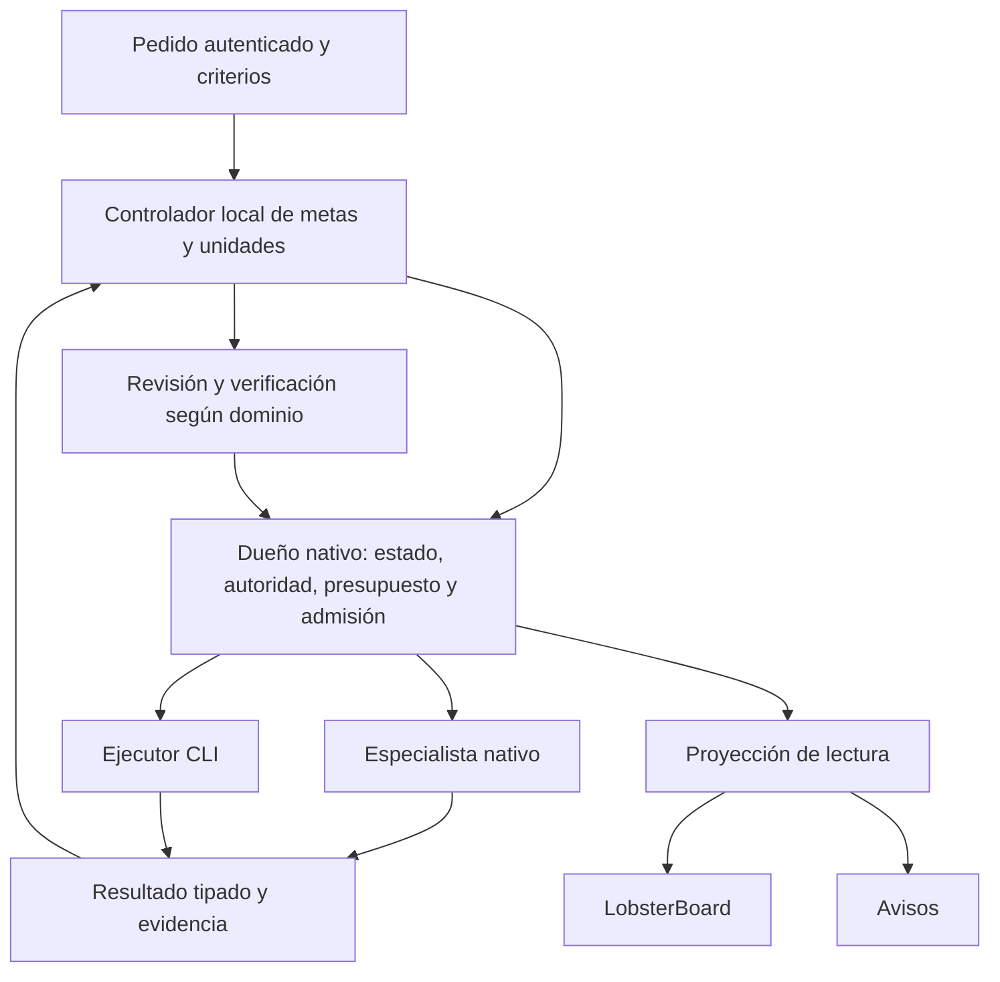

# Sistema unificado de agentes — diseño

Fecha: 2026-10-05. Estado: diseño propuesto completo; implementación no autorizada por este encargo.

Plan único: [Sistema unificado de agentes](../plans/2026-10-05-sistema-agentes-unificado.md).
Cobertura: [requisitos y ensayos](../../evidence/sistema-agentes-unificado/cobertura.md).

## Resultado

David encarga un resultado a OpenClaw o Hermes. La instalación conserva alcance,
permisos, presupuesto y criterios; prepara las unidades; elige especialistas y
ejecutores; revisa y verifica; muestra avance; entrega el resultado acreditado.
Los trabajadores pueden ser agentes nativos o CLI. Cada computadora funciona
sin la otra. Poteto es obligatorio en todas las rutas admitidas.

Este diseño sustituye las decisiones futuras incompatibles de U3b, U4, U5, U6 y
flota. Conserva evidencia y capacidades ya verificadas de U1, U3, U3a y encargos.
No convierte una fila antigua pendiente en trabajo terminado.

## How: recorrido completo



El diagrama se repite en cada instalación. No existe una cola, reloj o servicio
central entre ambas. El panel no ordena trabajo.

Ejemplo de ingeniería: A modifica backend, B modifica frontend y C comprueba la
integración. A y B usan worktrees y recursos distintos. C comienza una sola vez
cuando ambas dependencias tienen aceptación vigente. CI puede esperar mientras
avanza otra rama. Un reviewer independiente revisa el artefacto actual; un
verifier comprueba los criterios. Publicar o desplegar exige autoridad aplicable.

Ejemplo de Meli: el especialista recibe perfil, fuentes y herramientas de Meli.
Puede solicitar análisis auxiliar bajo la misma raíz. Un pedido de diagnóstico
no concede permiso para cambiar publicaciones. En mail, redactar no permite
enviar. Las tareas sin código acreditan su resultado sin fabricar un PR.

## Why: decisiones y cambios respecto de los planes anteriores

| Decisión | Razón y coste aceptado |
|---|---|
| Un controlador por instalación reúne meta y unidad | U3b y U6 decidían partes del mismo avance. Un único punto decide qué falta; evita coordinar dos motores. Sus reglas internas siguen separadas por dominio. |
| El dueño nativo guarda el estado operativo | R ya conserva resultados, consumo, hijos y presupuesto. Extender esa frontera evita otra base de tareas y otra conciliación entre autoridades. Requiere ampliar R. |
| Metas, aceptación y control desde la base | La UI debe representar hechos ya definidos; añadir pausa y aceptación después obligaría a migrar estados y permisos del director. |
| Contratos y ensayos comunes, implementación por host | Hermes debe funcionar sin OpenClaw. Compartir esquemas y casos permite implementaciones nativas sin imponer Node, Python o un gateway remoto común. |
| Flota prepara asignaciones; no gobierna metas | Modelo, especialidad y contexto cambian sin crear raíces, reiniciar gasto o acreditar resultados. |
| Controles de calidad propios del repo | Hooks, regresión y CI tienen utilidad demostrable. La cadena fija de CLIs y las reglas copiadas de quality-kit duplican coordinación y divergen. |
| Un plan con entregas por capacidad y host | Permite aceptar OpenClaw antes que Hermes, conservando un cierre total que exige ambos y Orbit. |

La comparación de dos alternativas y las razones históricas están en la
[revisión de diseño](../../evidence/sistema-agentes-unificado/revision.md).
No hay medición que permita prometer ahorro de tokens o tiempo.

## Módulos y propiedad

| Módulo | Decide o conserva | Ubicación objetivo |
|---|---|---|
| Controlador | Plan, dependencias, reparación, aceptación y siguiente acción | Módulo local del runtime; invocado por su scheduler existente |
| Política de ingeniería | Autor, revisión, CI, integración y recetas por repo | Funciones internas del controlador; recetas versionadas en G |
| Política de flota | Elegibilidad de especialista, ejecutor, modelo y contexto | Funciones internas y manifiestos versionados; mantenimiento local |
| Dueño nativo | Transacciones, permisos, reservas, tareas, procesos y recibos | R en OpenClaw; almacén y adaptador nativos en Hermes |
| Adaptadores de efectos | Ejecutan una intención admitida y devuelven recibo | Adaptadores CLI/host existentes ampliados; receta propia de Orbit |
| Proyección y emisor | Vista redactada, frescura, entrega de avisos | Proyección reconstruible y emisor único por host |
| Reviewer, verifier, adversario, advisor | Hallazgos, comprobaciones y objeciones dentro de sus permisos | Trabajadores admitidos; no son dueños del control ni del cierre |

G significa `goncloud-openclaw`; R, el checkout de integración del runtime;
O, `goncloud-Orbit`; H se identifica al inventariar Hermes. Las políticas no
tienen stores, colas o relojes propios. El controlador tampoco mantiene un
ledger operativo fuera del dueño nativo. El plan escrito es una entrada
versionada; `Plans.md` es un registro humano, no una segunda cola.

En OpenClaw se implementan decisiones y transacciones en R. G conserva recetas,
perfiles, adaptadores y ensayos. El cálculo útil de `corrida_worker` se migra o
se convierte en evidencia de compatibilidad; no queda un decisor Python activo
compitiendo con el nuevo. Hermes usa su lenguaje y mecanismos locales con los
mismos contratos y fixtures. No se construye un framework universal ni un
servicio de políticas para comunicar los hosts.

## Interfaz propuesta

Estas firmas describen comportamiento futuro. No son comandos disponibles.

```text
open(request, authority, idempotencyKey) -> GoalRef | Conflict
control(goal, Pause | Resume | Cancel, expectedControlEpoch, commandId) -> Receipt | Conflict
reconcile(goal) -> DecisionReceipt
read(goal) -> GoalView

decide(snapshot, verifiedFacts, policies) -> Decision             // pura
host.commit(goal, expectedPlanRevision, expectedControlEpoch,
            consumedResults, evidenceClaims, bindings, effects,
            decisionDigest) -> DurableReceipt | Conflict         // atómica
```

Los llamadores no encadenan por su cuenta reserva, spawn, registro y aceptación.
Las entradas CLI/RPC/config validan una vez los datos externos; el dominio recibe
tipos válidos. Los workers sólo entregan resultados y propuestas autorizadas.

| Tipo | Campos o estados esenciales |
|---|---|
| `Goal` | Raíz, solicitante autenticado, autoridad, presupuesto, revisión activa, época de control y política de calidad fijada |
| `Plan` | Digest inmutable, unidades, dependencias, criterios, supuestos, cobertura del pedido original |
| `Control` | `Active(epoch)`, `Paused(epoch, reason)`, `Cancelled(epoch, reason)` |
| `UnitBinding` | Clave única `(root, planRevision, unitId, attempt)` a tarea nativa |
| `Assignment` | Especialista, host, ejecutor, cuenta referenciada, modelo exacto o desconocido, effort/configuración, generación, permisos efectivos, contexto y atestaciones |
| `EvidenceClaim` | Criterio y versión, artefacto, dependencias, entorno, verificador autorizado, comando/procedimiento, resultado, fecha y caducidad aplicable |
| `Effect` | `Prepared`, `Started`, `Confirmed`, `Uncertain`; clave estable, alcance y época |
| `ProcessIdentity` | Instalación, boot ID, PID, creación, propietario y condición propio/adoptado |
| `Exception` | ID estable, tipo, opciones válidas, evidencia, destinatario y recibo de respuesta |
| `CorrectionBudget` | Clave estable `(root, blockLineageId)`, consumido/límite, hallazgos abiertos, diagnóstico/relevo usados y versión de política |

Plan, generación de flota y época de control son tipos distintos. Los resultados
de dominio requieren esquemas versionados explícitos; los actuales `ready.v1`
y `review.v1` no se convierten en bolsas de metadatos. Reportado, consumido,
recurso cerrado, unidad aceptada y meta cumplida son hechos diferentes.

## Transacciones, control y recuperación

R ya tiene `Continue`: consume el resultado de un padre y crea hijos con recibo
durable. No resuelve por sí solo A+B→C, hijos iniciales sin resultado padre,
revisión de plan, pausa o aceptación. El nuevo contrato debe:

1. Validar solicitante, permiso vigente, revisión, época y presupuesto.
2. Consumir recibos exactos y guardar claims emitidos por verificadores autorizados.
3. Comprobar dependencias aceptadas y reclamar el binding único de cada unidad.
4. Crear hijos bajo la misma raíz, reservar recursos y registrar intenciones.
5. Guardar el recibo de la decisión en la misma transacción.

Un replay con el mismo digest devuelve el mismo recibo; contenido distinto bajo
la misma clave es conflicto. Dos reconciliadores no pueden crear dos C. Una
transacción fallida no consume resultados a medias. Los hijos iniciales se
admiten explícitamente, sin fabricar una revisión o resultado padre.

El solicitante durable se autentica mediante una capacidad acotada emitida por
el host, vinculada al propietario del pedido. Conocer el ID de la raíz o cambiar
`agentId` no transfiere `resolve`. Una nueva sesión del propietario requiere
validación de identidad y recuperación de esa capacidad. Un especialista puede
proponer hijos; sólo una capacidad delegada explícita permite autorizarlos.

El punto de orden de un efecto es la transacción nativa `Prepared → Started`,
solicitada por el adaptador cuando está listo para despachar. Esa transacción
comprueba autoridad y época y emite el permiso único de inicio. Sólo ese permiso
habilita el envío externo; reservar una tarea o preparar un efecto no lo emite.
`Started` significa compromiso de inicio, aunque el destino aún no haya recibido
la solicitud. No se confunde con `Confirmed`.

Pausa persiste e incrementa la época antes del ACK, serializada con esa misma
transacción. Si pausa gana, el efecto permanece preparado y no puede enviarse.
Si `Started` gana, el envío puede ocurrir después del ACK de pausa: es un efecto
ya comprometido. El recibo de pausa/cancelación enumera esos efectos y los inciertos,
con ID, destino redactado, estado y posibilidad real de cancelación. El panel no
los muestra detenidos ni promete silencio externo inmediato. Se elige esta
semántica explícita; no se espera un lock de red ni se promete deshacerlos.

Cancelación es terminal. Reanudar conserva raíz, reservas, contadores e historia.
El resultado de cada control se guarda atómicamente por `commandId` y digest.
Repetir exactamente la orden devuelve su recibo original, sin otro incremento
de época; otra orden con época obsoleta da conflicto. El recibo histórico no
sustituye `read` para consultar el estado actual. Un permiso `Started` recuperado
tras crash se concilia antes de reenviar; conocerlo no autoriza un segundo envío.

Tras perder un ACK se consulta el recibo. Un efecto externo se reintenta sólo si
su destino garantiza idempotencia o la consulta prueba que no ocurrió. Si no se
puede determinar, queda `Uncertain`, conserva la reserva pertinente y exige
conciliación. No se promete exactamente una ejecución de un sistema externo que
no ofrece ese contrato. Las sesiones adoptadas no se detienen automáticamente.

Una revisión de plan invalida claims y admisiones afectados; conserva los válidos
con una justificación comprobable y mantiene obligaciones originales. Quitar un
criterio exige una modificación de alcance autenticada; el resultado registra
esa reducción, nunca la presenta como cumplimiento del pedido original.

Hay tres límites distintos: presupuesto del árbol, cupo físico del host y
carriles de ingeniería. Los recursos de escritura se reclaman de forma exclusiva
entre todas las raíces. Un par requiere dos plazas atómicas: con cupo cuatro y
tres ocupadas no cabe; con dos ocupadas sólo uno de dos pares concurrentes cabe.
Consumo CLI desconocido no se registra como cero. Una ruta sin medición usa
límites verificables conservadores o queda inelegible para ese presupuesto.

## Autoridad y calidad

La autoridad contiene acciones, repos/cuentas, datos, destino, plazo, presupuesto
y modo (`design`, lectura, implementación o publicación). Se intersecta con los
permisos del host, agente y CLI en arranque, resume y efecto. Un prompt no amplía
autoridad. SHA exacto significa ese SHA; elegir un SHA futuro requiere política
expresa de selección. No se pregunta otra vez por una operación ya autorizada.
Tamaño del plan por sí solo no crea una aprobación adicional.

El merge usa CI y reviewer del head exacto, check-run real del bot y autoridad
del repo. Se relee el merge remoto. Se retira la tabla adicional de merge sólo
al migrar sus consumidores; las preaprobaciones de diálogos son otro mecanismo.
La revisión lee fuente inmutable y escribe únicamente un resultado en un canal
dedicado. Otro harness se conserva para la revisión de código existente. Un
verifier acredita criterios; `approve` no sustituye sus pruebas.

### Política futura propuesta de revisión

`quality-policy.v2` permite como máximo **cuatro ciclos de corrección por bloque**,
contados desde la primera revisión con bloqueantes, dentro del presupuesto y
plazo de la raíz. Nuevos hallazgos, modelos, intentos, revisiones automáticas del
plan o nombres de unidad no reinician el contador del bloque lógico.
El dueño nativo conserva `blockLineageId` a través de esos cambios y lo heredan
las unidades correctivas. El planificador no puede crear otro linaje para eludir
hallazgos abiertos. Sólo una modificación de alcance/presupuesto autorizada puede
crear trabajo materialmente nuevo; queda auditada y no borra defectos ni gasto.

Dos repeticiones consecutivas del mismo bloqueante sin progreso activan un
diagnóstico independiente y, si queda presupuesto, un único relevo. Diagnóstico
y relevo no añaden ciclos. Si no existe corrección justificada, el bloqueante
reaparece tras el diagnóstico o se agota un límite, el bloque queda detenido con
evidencia. Un bloqueante abierto nunca pasa a backlog para poder cerrar o mergear.

Cada revisión agrupa hallazgos. Las rondas siguientes revisan el delta y su efecto
en contratos/dependencias. Un cambio fuera de ese delta invalida la evidencia
afectada. No se rota el modelo por ritual; una discrepancia, falta de independencia
o el diagnóstico exige otro revisor. Los no bloqueantes no abren ronda: ajuste
trivial en la misma o fila identificada del plan y mención en PR.

Un bloqueante requiere reproducción o evidencia estática verificable con archivo,
condición y procedimiento de comprobación. No se exige ejecutar una explotación
para acreditar un defecto de seguridad. Una sospecha sin evidencia abre una
investigación; no equivale a aprobación del criterio afectado.

Cuatro es un límite inicial propuesto, no una cifra medida ni una orden histórica
de David. Implementar la política no la activa. Su adopción requiere autoridad
que cubra expresamente sustituir stop2 por `quality-policy.v2` en los repos/hosts
indicados. Si la autorización del programa ya cubre ese cambio, se usa sin volver
a preguntar. Se registra recibo con principal, alcance, versión/digest anterior y
nuevo, fecha y read-back. Si falta ese alcance, se prepara inactiva y la activación
afectada espera la decisión; el resto del trabajo autorizado puede continuar.
Las raíces existentes conservan su versión de calidad; una promoción no amplía
sus ciclos. Mientras falte recibo de adopción rigen las reglas actuales, incluido
detener el mismo bloqueante en dos rondas. No se edita manualmente el bloque
administrado de AGENTS.md para adelantarse a esa migración.

Se conservan hooks sin `--no-verify`, regresión por bug, pruebas focalizadas durante
desarrollo y batería completa una vez sobre el artefacto final, preferentemente
en CI. Los shards cubren la unión íntegra; no se omiten pruebas por extensión de
archivo. Los checks rápidos de documentos/ledger se ejecutan además en su job.
Cambiar un corpus dispara su consumidor. Se elimina ejecución duplicada entre
jobs sólo después de probar cobertura. Reutilizar evidencia exige artefacto,
criterio, dependencias y entorno compatibles; datos vivos tienen frescura propia.

Quality-kit deja de ser coordinador obligatorio después de migrar consumidores,
instaladores y copias administradas. Hooks, runners y verificadores útiles quedan
versionados en cada repo. Su bootstrap puede seguir siendo opcional en otros repos.

## Flota, especialización y poteto

El selector primero respeta instrucciones y alcance; luego especialidad,
herramientas/permisos, poteto, acceso a proveedor/modelo, capacidad probada y
presupuesto. Entre elegibles utiliza calidad observada, latencia y coste. Registra
el motivo de selección. Rol, proveedor, familia y versión son dimensiones distintas.
Claude, GPT, Kimi, GLM, DeepSeek, Grok y otros participan cuando la cuenta y la
ruta estén autorizadas y acreditadas. Los nombres de ejemplo no acreditan acceso.

Cada intento fija modelo exacto, argumentos privados, contexto y generación. Un
launcher opaco muestra modelo no verificado; no participa donde se exija versión
exacta. Una promoción no cambia un intento activo ni su resume. Si el modelo se
retira, el relevo es un nuevo intento dentro de la misma raíz y presupuesto.

El scheduler existente mantiene el catálogo al arrancar, ante cambio de inventario
y cada 24 horas con jitter y backoff. Son valores iniciales configurables. Consulta
fuentes oficiales, acceso real y capacidades. Una relación de sucesión estable
verificada y un canary satisfactorio permiten promoción automática; orden
lexicográfico, nombre mayor o simple presencia en catálogo no bastan. Preview,
incompatibilidad o falta de permiso dejan una causa visible. No se compran accesos.
El mantenimiento tiene presupuesto propio acotado, usa el mismo cupo físico y no
añade un daemon o tarea permanente con modelo.

Los agentes se descubren desde inventarios efectivos, sin congelar una lista de
19. Un alta dentro de una plantilla autorizada debe validar perfil, herramientas,
poteto, especialidad y aristas de delegación/retorno. Entonces se publica, se prueba
y se habilita automáticamente. Un alta incompleta queda visible y reintentable,
sin recibir trabajo incompatible. Un retiro drena tareas antes de quitar conexiones.

Un perfil especializado declara tipos de tareas, límites, fuentes y caducidad,
skills requeridas y sus dependencias, herramientas y prueba de competencia. La
limpieza elimina referencias administradas ajenas al dominio; conserva memoria y
archivos del usuario. Una fuente vencida invalida sólo decisiones que dependen de
ella. El refresco registra procedencia y pasa prueba de dominio positiva y negativa.

El contexto incluye alcance y autoridad, poteto canónico con adaptación de
herramientas, especialidad, skills aplicables y evidencia pertinente. No se recorta
poteto a una etiqueta. Se comprueban entrega y conducta en seis rutas: turno nativo,
hijo nativo, encargo gestionado, inicio CLI, resume CLI e hijo CLI. Hash identifica
contenido; no demuestra que el modelo lo recibió o pudo usar sus herramientas.
Falta de una ruta requerida impide admitirla, sin deshabilitar otras acreditadas.

Advisor observa eventos y comunica objeciones sin despachar, editar ni aceptar.
Sin flujo completo declara `checkpoint-only`; timeout o silencio no son aprobación.
Adversario y segunda opinión se asignan cuando el procedimiento poteto o riesgo
lo exige. Sus hallazgos entran en el mismo ciclo, sin crear otra autoridad de cierre.

### OpenCode

Se aprovechan perfiles, contexto por rol y telemetría. Se usa el adaptador CLI
existente tras certificar configuración efectiva, modelo, permisos y herramientas
de hijos. Los siete perfiles locales sin permisos explícitos no se consideran
confinados. La ruta local inspeccionada autoriza `zai-coding-plan`; otras cuentas
requieren autoridad real, aunque la arquitectura sea multivendor.

No se adopta otro agente `main` como director, `SMALL` sin revisión, `PASS` textual,
dos loops fijos ni background experimental como dependencia. Un worktree separa
escrituras Git; no es sandbox. La certificación verifica también herramientas shell
que podrían escribir aunque la herramienta `edit` esté deshabilitada.

## Proyección, reloj y publicación

La vista distingue avance declarado, observado y aceptado. El porcentaje usa
criterios obligatorios con pesos fijados al aceptar la revisión; sin criterios
válidos muestra indeterminado. Cien por ciento exige aceptación integrada actual.
Ni proceso vivo, `LISTO`, merge, rollback o eliminación de una unidad lo producen.

Panel y avisos leen el mismo snapshot redactado: host, responsable, especialista,
CLI, modelo acreditado, intento, espera, próxima comprobación, recursos, evidencia,
frescura y error. Métricas faltantes son desconocidas. PID reutilizado no permite
atribuir ni detener un proceso. La proyección permite sólo campos y URLs autorizados,
escapa texto y limita tamaños; excluye secretos, prompts, argv y transcripciones.

El scheduler invoca el controlador por eventos y reconciliación recuperable. Un
latido inicial de cinco minutos comprueba trabajo pendiente sin modelo; vigilancia
de recursos cada quince y aviso consolidado máximo cada treinta mientras haya
pendientes. Excepciones se notifican de inmediato; reaviso no antes de sesenta.
Son intervalos configurables, no procesos distintos. Se conserva la respuesta
inmediata ya probada en U3a. Un envío fallido no adelanta el checkpoint; se expone
el fallo. La entrega se deduplica según capacidad del transporte, sin prometer
exactamente una notificación cuando no hay consulta o clave idempotente.

Se prueba LobsterBoard original y una plantilla existente en móvil/escritorio antes
de adaptarlo. Se fija commit, licencia, assets y dependencias. El upstream consultado
usa BSL 1.1 con condiciones para uso interno; no se etiqueta MIT hoy. La licencia
del commit elegido y el uso previsto se comprueban al adoptar. Huecos pequeños
medidos justifican cambios; una reescritura amplia detiene el bloque UI y presenta
alternativas acotadas. No hay fallback automático a una aplicación propia.

Cada host publica por generación: preparado → aplicado → verificado → activo.
Aplicación sin atestación cerca admisiones afectadas. La activación comprueba la
generación y revisión esperadas; dos publicadores no se pisan. Restaurar conserva
revocaciones, presupuesto y control vigente. Los nuevos destinos de agentes deben
entrar en el manifiesto de publicación autorizado; copiar archivos no activa plugins.

## Transición y límites

Por entrada: inventariar dueño y consumidores; instalar observación en sombra;
cerrar admisión antigua; drenar; conciliar tareas, resultados y reservas; cambiar
dueño/generación por CAS; activar la nueva ruta. El registro de propiedad que ambos
lanzadores consultan impide doble despacho durante un crash del corte. Las entradas
sin migrar conservan su dueño. Sólo después se retiran crons compartidos, wrappers
y copias obsoletas; los crons de negocio permanecen.

La reversa de software conserva el store compatible. Si hubo admisiones nuevas,
volver al dueño anterior requiere drenaje y migración inversa verificable; si no
existe, se mantiene pausada la ruta y se repara hacia adelante. No se habilitan dos
dueños como reversa rápida. U1/T11–T12 siguen siendo mecanismos de publicación y
corte; se amplían sus faltantes, no se reconstruyen fases cerradas.

Hermes aún requiere inventario de APIs, instalación y plataforma. Si falta una
frontera durable, se implementa localmente antes de aceptarlo. No se simula mediante
un proxy a OpenClaw. La aceptación OpenClaw puede cerrar primero; la aceptación del
programa exige ambos hosts y la entrega de Orbit con sus recibos.

## Fuentes externas contrastadas

- [Hermes oficial](https://github.com/NousResearch/hermes-agent): referencia del host; no acredita la instalación del usuario.
- [LobsterBoard](https://github.com/Curbob/LobsterBoard) y [licencia upstream consultada](https://raw.githubusercontent.com/Curbob/LobsterBoard/main/LICENSE): adopción sujeta al commit fijado y prueba pendiente.
- Las inspecciones locales de OpenCode y quality-kit, commits y límites están en la [revisión](../../evidence/sistema-agentes-unificado/revision.md).
